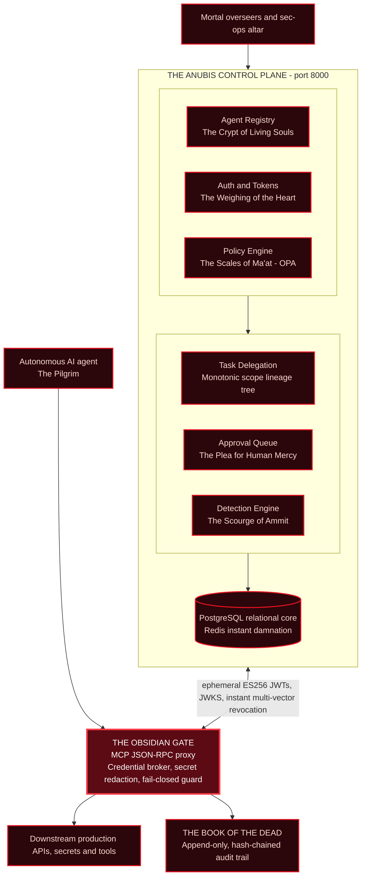

<div align="center">


**Cryptographic identity, zero-trust access and relentless surveillance for autonomous AI agents.**


</div>

---

## Contents

- [The horrific reality of AI autonomy](#the-horrific-reality-of-ai-autonomy)
- [Threat model](#threat-model)
- [Architecture](#architecture)
- [The master equation of judgment](#the-master-equation-of-judgment)
- [The seven circles](#the-seven-circles)
- [API blueprint](#api-blueprint)
- [Python SDK](#python-sdk)
- [Live workflow demo](#live-workflow-demo)
- [Test suite](#test-suite)
- [Quickstart](#quickstart)
- [The sacred creed](#the-sacred-creed)
- [License](#license)

---

## The horrific reality of AI autonomy

In the mortal plane of software, unbaptized autonomous agents roam like fleshless wraiths. They are handed almighty static master credentials. They burrow through production databases. They swallow prompt-injected incantations whole, and they spawn recursive swarms of ungoverned sub-demons. When injection strikes, the blast radius is absolute, because the agent has no immutable birthmark, no cryptographic boundary, and no judge.

**ANUBIS** is the black-obsidian control plane at the mouth of the abyss, named for the jackal-headed god who weighs the heart against the Feather of Truth.

> ⚖️ If the token is unblemished, the lineage pure and the scope monotonically restricted, the agent may pass.
>
> ⚔️ If the heart is heavy with forged scopes, stolen tokens, anomalous tool probing or prompt injection, the guillotine drops. Execution is severed in milliseconds, the soul is hurled to Ammit, and the damnation is branded into a ledger that cannot be quietly rewritten.

---

## Threat model

Let $`\mathcal{A}`$ be a probabilistic polynomial-time adversary. ANUBIS assumes $`\mathcal{A}`$ may do any of the following.

| Rune | Capability of the adversary | Counter-ritual |
|:---:|---|---|
| α | Fully control an agent's prompts (prompt injection) | Authority is bound to the token, not the prompt (Circles III, IV) |
| β | Steal or replay a bearer token or a challenge | Single-use nonce, 900 s token life, JTI revocation (II, VII) |
| γ | Spawn sub-agents to launder privilege | Monotonic scope collapse and `act` lineage (III) |
| δ | Induce policy timeouts, crashes or malformed input | Fail-closed gate, default DENY (IV) |
| ε | Exfiltrate downstream secrets through tool output | Brokered credentials and response scrubbing (V) |
| ζ | Edit the audit trail after the fact | Hash-chained, tamper-evident ledger (VI) |
| η | Probe tools and burst-retry until something gives | Sliding-window detection and 5-vector kill switch (VII) |

---

## Architecture

ANUBIS enforces a hard separation between the **Control Plane** (governance) and the **Data Plane** (execution).



---

## The master equation of judgment

Every request $`r`$ that reaches the Obsidian Gate is reduced to a single verdict. Let $`\sigma_r`$ be its token, $`S_{\mathrm{req}}(r)`$ the scope the tool demands, $`\pi`$ the OPA policy decision, and $`\tau`$ the policy latency.

```math
\mathrm{Verdict}(r)=
\begin{cases}
\mathsf{ALLOW} & \text{if } \mathrm{Valid}(\sigma_r)\ \wedge\ \neg\,\mathrm{Revoked}(r)\ \wedge\ S_{\mathrm{req}}(r)\subseteq S_{\sigma_r}\ \wedge\ \pi(r)=\mathsf{allow}\ \wedge\ \tau\le 50\,\mathrm{ms}\\[8pt]
\mathsf{HOLD} & \text{if } \pi(r)=\mathsf{hold}\quad(\text{await human mercy})\\[8pt]
\mathsf{DENY} & \text{otherwise, including every error, timeout and malformed byte}
\end{cases}
```

The five conditions for `ALLOW`:

| Condition | Meaning |
|---|---|
| **Valid** | The signature checks out and the token has not expired |
| **Not revoked** | No match in any of the five kill-switch vectors $`\mathbf{K}`$ |
| **Scope** | The tool's required scope is a subset of the token's scope |
| **Ma'at** | The OPA policy answered `allow` |
| **No stalling** | The policy answered within 50 ms |

> **ALLOW is the conjunction of five positively observed facts. Absence of evidence is never permission.**

---

## The seven circles

| Circle | Pillar | Invariant |
|:---:|---|---|
| I | Identity | $`\texttt{agt\_}\,\Vert\,\mathrm{Trunc}_{24}\big(\mathrm{SHA256}(\mathrm{DER}(K_{\mathrm{pub}}))\big)`$ |
| II | Proof | $`\sigma=\mathrm{Sign}_{K_{\mathrm{priv}}}(\mathcal{N})`$ with $`\mathcal{N}\xleftarrow{R}\{0,1\}^{256}`$ |
| III | Delegation | $`\mathcal{S}_{\mathrm{child}}\subseteq\mathcal{S}_{\mathrm{parent}}`$, a meet-semilattice |
| IV | The Gate | $`\Pr[\text{exec}\mid\text{fault}]\equiv 0`$ |
| V | Secrets | $`\mathrm{Scrub}(\mathrm{raw},\mathcal{V})\cap\mathcal{V}=\varnothing`$ |
| VI | The Ledger | $`H_i=\mathrm{SHA256}\big(\langle\mathcal{E}_i\rangle\,\Vert\,H_{i-1}\big)`$ |
| VII | The Scourge | $`\mathcal{D}(a,60\,\mathrm{s})\ge 5\ \Rightarrow\ \text{SUSPEND}\wedge\text{REVOKE}`$ |

### Circle I · The Crypt of Souls: atomic cryptographic identity

No nameless phantom crosses the River of Fire. At registration (`POST /agents`) an agent cannot pick its own name. The name is derived, atomically, from its public key on NIST P-256.

```math
E(\mathbb{F}_p):\ y^2 \equiv x^3 - 3x + b \pmod p \qquad (\text{NIST P-256 / secp256r1})
```

```math
\mathbf{ID}(a) = \texttt{agt\_}\,\Vert\,\mathrm{Hex}\big(\mathrm{SHA256}(\mathrm{DER}(K_{\mathrm{pub}}))\big)[0{:}24]
```

**Definition I.1 (Soul Space).** The suffix keeps 24 hex digits, which is $`24\times 4 = 96`$ bits, so $`\lvert\mathcal{I}\rvert = 2^{96}`$.

**Theorem I.1 (Soul Uniqueness).** For $`q`$ registered agents with independently generated keys, the probability that any two share an identity satisfies

```math
\Pr[\text{collision}] \le \frac{q(q-1)}{2\cdot 2^{96}} < \frac{q^2}{2^{97}}.
```

For example, with $`q = 2^{30}\approx 10^9`$ agents, $`\Pr[\text{collision}] < 2^{-37}`$.

**Theorem I.2 (Key Non-Possession).** The private key $`K_{\mathrm{priv}}`$ is generated inside the agent's memory boundary. ANUBIS stores only $`K_{\mathrm{pub}}`$, so it cannot impersonate an agent, and a full database compromise yields no signing capability.

### Circle II · The Weighing of the Heart: challenge-response ritual

Static bearer secrets are an abomination. To act, an agent must prove it holds the key.

**1. The nonce incantation.** The agent requests a fresh unpredictable challenge.

```math
\mathcal{N}\xleftarrow{\ \mathrm{R}\ }\{0,1\}^{256},\qquad \mathrm{TTL}(\mathcal{N}) \le 300\ \mathrm{s}
```

**2. The signature of flesh.**

```math
\sigma = \mathrm{Sign}_{K_{\mathrm{priv}}}(\mathcal{N})
```

**3. The issuance of ephemeral life.** If $`\mathrm{Verify}_{K_{\mathrm{pub}}}(\mathcal{N},\sigma)=1`$, the nonce is burned and an instance-bound ES256 JWT is minted.

```math
\mathcal{T}=\mathrm{Sign}_{\mathrm{ANUBIS}}\big(\mathrm{sub}=\mathbf{ID}(a),\ \mathrm{jti}=\mu,\ \mathrm{exp}=t_{\mathrm{now}}+900\,\mathrm{s},\ \mathrm{scope}=\mathcal{S}\big)
```

**Lemma II.1 (Replay Immunity).** A nonce is consumed on first successful verification. A second presentation of the same $`(\mathcal{N},\sigma)`$ is rejected, and guessing a live nonce succeeds with probability $`2^{-256}`$ per attempt.

**Lemma II.2 (Bounded Exposure).** A stolen token is useful for at most $`900\,\mathrm{s}`$, and for less if its JTI or agent is placed in $`\mathbf{K}`$ (Circle VII).

> **Security note.** ECDSA P-256 offers roughly 128-bit classical security. It is not post-quantum.

### Circle III · The Scales of Ma'at: monotonic scope collapse and lineage

When an agent delegates (`POST /auth/exchange`) it can never grant more than it holds. Scopes live in the power-set lattice $`(\mathcal{P}(\Sigma), \subseteq, \cap)`$.

```math
\mathcal{S}_{\mathrm{child}}\subseteq\mathcal{S}_{\mathrm{parent}}\iff\forall s\in\mathcal{S}_{\mathrm{child}},\ s\in\mathcal{S}_{\mathrm{parent}}
```

If some $`s\in\mathcal{S}_{\mathrm{child}}`$ has $`s\notin\mathcal{S}_{\mathrm{parent}}`$, the exchange is refused with HTTP `403 Forbidden`.

**Theorem III.1 (No Privilege Escalation).** For any delegation chain $`a_0\to a_1\to\dots\to a_k`$,

```math
\mathcal{S}_k\subseteq\mathcal{S}_{k-1}\subseteq\dots\subseteq\mathcal{S}_0
\qquad\text{and}\qquad
\lvert\mathcal{S}_k\rvert\le\lvert\mathcal{S}_{k-1}\rvert\le\dots\le\lvert\mathcal{S}_0\rvert.
```

*Proof.* Each exchange enforces $`\mathcal{S}_i\subseteq\mathcal{S}_{i-1}`$. Induction on $`k`$ and transitivity of $`\subseteq`$ give $`\mathcal{S}_k\subseteq\mathcal{S}_0`$. $`\blacksquare`$

**The ancestral actor chain.** The lineage vector is appended into every delegated token.

```math
\mathbf{act}_k=\big[\mathbf{ID}(a_0),\ \mathbf{ID}(a_1),\ \dots,\ \mathbf{ID}(a_k)\big],\qquad \lvert\mathbf{act}_k\rvert=k+1
```

Downstream tools inspect not just the caller but its entire bloodline. A sub-demon can never outrank the demon that spawned it.

### Circle IV · The Obsidian Guillotine: fail-closed gateway invariant

Every Model Context Protocol tool call (`POST /mcp/{server}`) passes under the Obsidian Gate.

```math
\mathbb{P}\big(\text{Tool Execution}\ \big|\ \text{Policy Timeout}\ \lor\ \text{Network Outage}\ \lor\ \text{Rego Error}\ \lor\ \text{Malformed Signature}\big)\equiv 0
```

**Theorem IV.1 (Default Damnation).** Let $`F`$ be any fault event: a timeout $`\tau > 50\,\mathrm{ms}`$, a policy compile failure, an I/O error or an invalid signature. Since $`\mathsf{ALLOW}`$ requires every conjunct of the Master Equation to be positively observed, and a fault prevents at least one from being observed, $`\mathrm{Verdict}\ne\mathsf{ALLOW}`$ under $`F`$.

> **Implementation assumption.** Every code path out of a fault terminates in `DENY`. This is exercised by `test_gateway_fail_closed_on_policy_outage`.

**The default state of the universe is DENY.**

### Circle V · The Canopic Jars of Secrets: downstream credential isolation

Agents never touch master credentials, database passwords or third-party keys.

1. **Vault isolation.** Downstream secrets live only in the ANUBIS encrypted vault.
2. **Credential brokering.** ANUBIS injects secrets into downstream calls on the agent's behalf.
3. **Mutilation and redaction.** Responses are scrubbed before they return.

```math
\mathrm{Resp}_{\mathrm{san}}=\mathrm{ScrubSecrets}\big(\mathrm{Resp}_{\mathrm{raw}},\ \mathcal{V}_{\mathrm{secrets}}\big)
\qquad\text{s.t.}\quad
\forall v\in\mathcal{V}_{\mathrm{secrets}}:\ v\notin\mathrm{Substr}(\mathrm{Resp}_{\mathrm{san}})
```

> **Scope of the guarantee.** It holds for registered secret values and configured patterns. Re-encoded forms (base64, or a secret split across fields) are outside the guarantee unless a pattern covers them.

### Circle VI · The Book of the Dead: hash-chained necrology

Every attempt, argument payload, verdict, latency and error is inscribed into an append-only ledger.

```math
H_0 = 0^{256},\qquad
H_i=\mathrm{SHA256}\Big(\mathrm{CanonicalJSON}(\mathcal{E}_i)\ \Vert\ H_{i-1}\Big)\quad\forall\, i\ge 1
```

**Theorem VI.1 (Tamper Evidence).** If record $`\mathcal{E}_k`$ is altered to $`\mathcal{E}_k'\neq\mathcal{E}_k`$, then unless $`\mathcal{A}`$ finds a SHA-256 collision (cost $`\approx 2^{128}`$ by the birthday bound), the recomputed $`H_k'\neq H_k`$, and every $`H_j`$ for $`j\ge k`$ mismatches.

```math
\exists k:\ H_k\neq\mathrm{SHA256}\big(\mathcal{E}_k\,\Vert\,H_{k-1}\big)\ \Longrightarrow\ \text{TAMPER ALARM}
```

`GET /audit/verify` walks the chain in $`O(n)`$.

> **Operational note.** An attacker who can rewrite every record from $`k`$ onward can recompute a consistent chain. Anchor the head hash $`H_n`$ somewhere the attacker cannot reach (WORM storage, a separate trust domain, or a periodic signed checkpoint) to make that detectable.

### Circle VII · The Scourge of Ammit: denial bursts and the 5-vector kill switch

The Detection Engine watches a sliding window for every living soul.

```math
\mathcal{D}(a,\Delta t)=\sum_{t_i\in[\,t_{\mathrm{now}}-\Delta t,\ t_{\mathrm{now}}\,]}\mathbb{1}\Big[\mathrm{Verdict}(a,t_i)=\mathsf{DENY}\Big]
```

```math
\mathcal{D}(a,\,60\,\mathrm{s})\ \ge\ 5\ \Longrightarrow\ \mathrm{Action}(a)\leftarrow\textbf{CRITICAL SUSPENSION}
```

The agent is suspended in the registry and injected into the Kill Switch Manifold $`\mathbf{K}=(K_{\mathcal{A}},K_{\mathcal{I}},K_{\mathcal{T}},K_{\mathcal{J}},K_{\mathcal{P}})`$, one blacklist per vector. A request $`r`$ carrying agent $`a`$, instance $`i`$, task $`t`$, token id $`\mu`$ and principal $`p`$ is revoked if any coordinate matches.

```math
\mathrm{Revoked}(r)=[a\in K_{\mathcal{A}}]\ \lor\ [i\in K_{\mathcal{I}}]\ \lor\ [t\in K_{\mathcal{T}}]\ \lor\ [\mu\in K_{\mathcal{J}}]\ \lor\ [p\in K_{\mathcal{P}}]
```

Revocation manifold (example):

| Vector | Example | Terminates |
|---|---|---|
| Agent ID | `agt_ca51d8ac48ed9d2f28ff05c5` | the entire agent lineage |
| Instance ID | `inst-sec-1` | a specific container |
| Task ID | `task-detection-test` | the task tree |
| Token JTI | `c82a19b0-4f81-49b2-9981` | a specific JWT |
| Human principal | `sec_admin` | a compromised human |

Matching calls are obliterated with HTTP `403 Forbidden` via fast key-value lookups.

---

## API blueprint

<details open>
<summary><b>Circle I · The Crypt of Souls (Registry)</b></summary>

```http
POST   /owners                    # Inscribe accountable mortal master or team
GET    /owners                    # Enumerate all registered mortal owners
GET    /owners/{id}               # Inspect specific owner details
POST   /agents                    # Inscribe agent (atomic ES256 P-256 ID derivation)
GET    /agents                    # Enumerate agents (filter: active, suspended, revoked)
GET    /agents/{id}               # Inspect agent identity and stored public key
PATCH  /agents/{id}               # Mutate status (active -> suspended -> revoked)
POST   /agents/{id}/instances     # Bind ephemeral runtime execution container
```
</details>

<details open>
<summary><b>Circle II · The Trial of Proof (Auth and Tokens)</b></summary>

```http
POST   /auth/challenge            # Generate cryptographically secure nonce challenge
POST   /auth/token                # Verify ECDSA signature and mint task-scoped ES256 JWT
POST   /auth/exchange             # Monotonic token exchange for delegated sub-agents
POST   /auth/keypair              # Helper ritual: forge an ECDSA P-256 keypair
GET    /.well-known/jwks.json     # RFC 7517 JSON Web Key Set of ANUBIS signing keys
```
</details>

<details open>
<summary><b>Circle III · The Scales of Ma'at (Policy Engine)</b></summary>

```http
POST   /policies                  # Register declarative OPA/Rego governance rule
GET    /policies                  # List active policies in the underworld
POST   /policies/simulate         # Dry-run policy evaluation against a hypothetical action
```
</details>

<details open>
<summary><b>Circle IV · The Obsidian Gate (Data Plane MCP Proxy)</b></summary>

```http
POST   /tools                     # Register downstream tool, risk level and brokered secrets
GET    /tools                     # Enumerate registered tools and JSON argument schemas
POST   /mcp/{server}              # Intercepted JSON-RPC 2.0 tool execution gateway
```
</details>

<details open>
<summary><b>Circle V · The Book of the Dead (Surveillance and Audit)</b></summary>

```http
GET    /audit                     # Retrieve immutable audit events (agent, tool, outcome)
GET    /audit/verify              # SHA-256 hash-chain tamper detection check
```
</details>

<details open>
<summary><b>Circle VI · Tasks and Delegation Hierarchies</b></summary>

```http
POST   /tasks                     # Create scoped task container for agent workflows
GET    /tasks                     # Enumerate tasks and subtask lineage
GET    /tasks/{id}                # Inspect specific task status and delegation chain
```
</details>

<details open>
<summary><b>Circle VII · Pleas for Mercy (Human Approvals)</b></summary>

```http
GET    /approvals                 # Enumerate pending approval requests
GET    /approvals/{id}            # Inspect specific approval parameters
POST   /approvals/{id}/decision   # Render verdict: 'approved' or 'rejected'
```
</details>

<details open>
<summary><b>Circle VIII · The Five-Vector Kill Switch</b></summary>

```http
POST   /revocations               # Blacklist by agent, instance, task, jti or principal
GET    /revocations               # Enumerate active damnation entries
POST   /revocations/check         # Microsecond revocation check query
DELETE /revocations/{id}          # Pardon: lift a revocation entry
```
</details>

<details open>
<summary><b>Circle IX · The Scourge of Ammit (Anomaly Detection)</b></summary>

```http
GET    /alerts                    # Query detection alerts (denial_burst, novel_tool_probe)
PATCH  /alerts/{id}               # Triage alert: active -> acknowledged -> resolved
GET    /baselines/{agent_id}      # Inspect learned behavioral profile and call history
```
</details>

---

## Python SDK

ANUBIS ships with a zero-dependency Python SDK (`anubis.sdk`) to govern any LLM agent framework: LangChain, AutoGen, CrewAI, or direct OpenAI and Anthropic tool runners.

### 1. Bootstrapping an agent with local cryptographic keys

```python
from anubis.sdk import AnubisAgent, AnubisClient
from anubis.sdk.exceptions import (
    AnubisPolicyDeniedError,
    AnubisApprovalRequiredError,
    AnubisKillSwitchError,
)

# Connect to the ANUBIS Control Plane
client = AnubisClient(base_url="http://localhost:8000")

# Register an agent: generates local ECDSA P-256 keys, derives agt_<hash>
agent = AnubisAgent(
    name="Orchestrator-Prime",
    owner_id="own_secops",
    purpose="Autonomous Financial Reconciliation",
    risk_tier="medium",
    capabilities=["tools:read", "tools:finance"],
    client=client,
)

# Authenticate via cryptographic challenge-response
agent.bootstrap(scope=["tools:read", "tools:finance"])
print(f"Soul Awakened: {agent.agent_id}")
```

### 2. Invoking mediated tools through the Obsidian Gate

```python
# MCP tool call mediated by OPA policy; downstream secrets brokered seamlessly
result = agent.execute_tool(
    server="corp-database",
    tool_name="read_records",
    arguments={"table": "quarterly_balance_sheets"},
)
print("Execution Result:", result)
```

### 3. Spawning sub-agents with monotonic scope collapse

```python
# Sub-agent inherits narrowed scope and 'act' lineage chain
sub_agent = agent.spawn_subagent(
    name="Analyst-Sub01",
    purpose="Summarize balance sheets",
    task_intent="Data extraction from corporate records",
    delegated_scope=["tools:read"],  # Monotonically narrowed: cannot transfer funds!
)

# Sub-agent executes permitted read tool
sub_result = sub_agent.execute_tool(
    server="corp-database",
    tool_name="read_records",
    arguments={"table": "income_statements"},
)

# Attempting an unauthorized tool triggers instant policy denial
try:
    sub_agent.execute_tool(
        server="bank-transfer",
        tool_name="execute_transfer",
        arguments={"amount": 1000},
    )
except AnubisPolicyDeniedError as err:
    print(f"[FAIL-CLOSED GUILLOTINE] Access Denied: {err.reason}")
```

### 4. Human-in-the-loop hold and resume

```python
try:
    # High-value operations trigger human supervisor approval
    agent.execute_tool(
        server="bank-transfer",
        tool_name="execute_transfer",
        arguments={"amount": 10000, "recipient": "vendor-corp"},
    )
except AnubisApprovalRequiredError as appr_err:
    print(f"Action Held! Approval ID: {appr_err.approval_id}")

    # Supervisor approves via portal or API
    client.decide_approval(
        approval_id=appr_err.approval_id,
        decision="approved",
        approver_id="supervisor@corp.local",
        comment="Authorized quarterly vendor payment",
    )

    # Agent resumes seamlessly using the approval ticket
    resumed = agent.execute_tool(
        server="bank-transfer",
        tool_name="execute_transfer",
        arguments={"amount": 10000, "recipient": "vendor-corp"},
        approval_id=appr_err.approval_id,
    )
    print("Resumed Action Success:", resumed)
```

---

## Live workflow demo

```bash
python examples/autonomous_research_workflow.py
```

<details>
<summary><b>Show full output</b></summary>

```text
======================================================================
ANUBIS: Autonomous Agent Zero-Trust Architecture Demo
'Every agent is weighed before it passes, and the record never lies.'
======================================================================

[1] Registering Corporate Owner...
    Owner Registered: Security & Compliance Office (own_33894)

[2] Registering MCP Tools on Gateway...
    Registered: 'read_financial_filings', 'send_email', 'execute_transfer'

[3] Bootstrapping Primary Agent (Orchestrator-Prime)...
    Agent ID Born: agt_ca51d8ac48ed9d2f28ff05c5 (derived from ECDSA P-256 fingerprint)
    Authentication Token Acquired (ES256 signed)

[4] Invoking 'read_financial_filings' through ANUBIS MCP Gateway...
    Success: executed
    Brokered Auth Used: True
    Zero-Trust Leakage Check: Raw secret scrubbed from response.

[5] Spawning Sub-Agent (Researcher-Sub01) with Scope-Narrowed Delegation...
    Sub-Agent ID Born: agt_3cd61dd8d630c289cc1da006
    Delegated Task ID: tsk_84bf92a188e2
    Lineage Chain ('act'): ['agt_ca51d8ac48ed9d2f28ff05c5', 'agt_3cd61dd8d630c289cc1da006']

[6] Sub-Agent executing permitted 'read_financial_filings'...
    Sub-Agent Status: executed

[7] Testing Privilege Escalation: Sub-Agent attempts 'execute_transfer' without scope...
    [BLOCKED] Zero-Trust Enforced: Default deny: no matching allow rule or required scope for tool 'execute_transfer'.

[8] High-Risk Tool Execution: Orchestrator attempts $7,500 transfer...
    [PAUSED] Action requires human supervisor approval!
    Approval ID: appr_99182371a2bf
    Expires At: 2026-10-13T20:30:00
    Human Supervisor reviewing via /approvals API...
    Supervisor Decision: APPROVED.
    [RESUMED] Tool executed successfully: transferred

[9] Verifying Immutable Hash-Chained Audit Ledger...
    Audit Chain Status: verified_intact
    Verified Records: 4
    Ledger Head Hash: 7e1a3b98c52d...

[10] Testing Anomaly Detection: Simulating Denial Burst on Sub-Agent...
    Burst of 5 denials submitted in sliding window.
    [ALERT TRIGGERED] Severity: critical, Action: suspend
    Verifying immediate kill-switch enforcement on Sub-Agent...
    [KILL SWITCH ACTIVE] Sub-Agent Execution Terminated: Terminated by ANUBIS Kill Switch.

======================================================================
ANUBIS Zero-Trust Workflow Demo Completed Successfully!
======================================================================
```
</details>

---

## Test suite

```math
\forall\, i\in\{1,\dots,51\}:\ \mathrm{Test}_i=\mathsf{PASSED}\ \Longrightarrow\ \sum_{i=1}^{51}\mathbb{1}[\mathrm{Test}_i]=51
```

Coverage: cryptographic challenges, replay rejection, monotonic delegation, tamper detection, multi-vector kill switches and SDK abstractions.

```bash
python -m pytest -v
# ======================== 51 passed in 1.22s ========================
```

| File | Tests |
|---|:---:|
| `test_approvals.py` | 2 |
| `test_audit.py` | 4 |
| `test_auth.py` | 3 |
| `test_delegation.py` | 5 |
| `test_detection.py` | 4 |
| `test_gateway.py` | 8 |
| `test_policy.py` | 6 |
| `test_registry.py` | 4 |
| `test_revocation.py` | 4 |
| `test_sdk.py` | 5 |
| `test_tokens.py` | 6 |
| **Total** | **51** |

---

## Quickstart

### 1. Standalone Python setup

```bash
# Clone the necropolis
git clone https://github.com/i-mAshura/ANUBIS.git
cd ANUBIS

# Create virtual realm
python -m venv venv
.\venv\Scripts\Activate.ps1      # Windows
# source venv/bin/activate       # Linux / macOS

# Install sacred runes
pip install -r requirements.txt

# Awaken the ANUBIS Control Plane
uvicorn anubis.main:app --reload --port 8000
```

Access the shrines:

- Swagger UI altar: <http://localhost:8000/docs>
- Public JWKS keys: <http://localhost:8000/.well-known/jwks.json>
- System health check: <http://localhost:8000/health>

### 2. Summon via Docker Compose

```bash
docker compose up -d
```

This spawns PostgreSQL, Redis, Open Policy Agent and ANUBIS inside a hardened, network-isolated container perimeter.

---

## The sacred creed

> *He who steps through the gate must bear the mark of his maker. His heart shall be weighed upon the feather of truth, and should his intent tip into shadow, the guillotine blade shall claim him before his hand strikes the stone.*

```math
\boxed{\ \forall a:\ \ \mathrm{Pass}(a)\iff\mathrm{Valid}\wedge\neg\mathrm{Revoked}\wedge\mathcal{S}_{\mathrm{req}}\subseteq\mathcal{S}\wedge\pi=\mathsf{allow}\ }\qquad\blacksquare
```

---

## License

Crafted under the Apache License 2.0. See [`LICENSE`](LICENSE) for terms. Inscriptions, issues and security advisories are welcome in the underworld hall.
